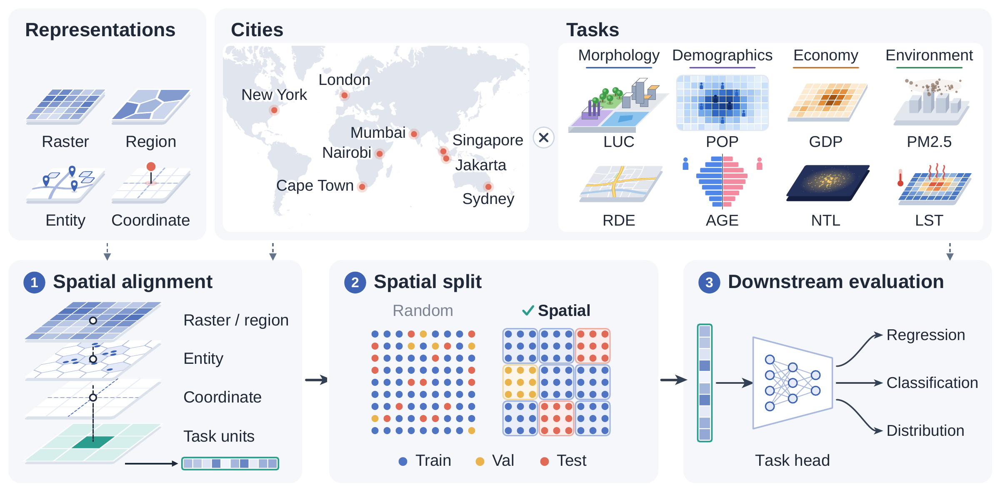

# CityRep

Code and data for CityRep, a benchmark for urban representations across eight
cities, eight downstream tasks, and heterogeneous spatial supports (rasters, H3
regions, POI/map entities, and coordinate encoders).

[](figures/fig01_cityrep_framework.pdf)

| Path | Contents |
|---|---|
| `urban_benchmark/` | Evaluation package: alignment, spatial splits, downstream heads, metrics, CLI |
| `configs/release/protocols.json` | Evaluation protocols used in the paper |
| `data/tasks/`, `data/tasks.json` | Downstream task data for the 8 cities x 8 tasks |
| `baselines/` | Manifest of the released baseline embeddings |
| `data_preparation/` | Download scripts for the raw inputs used to build the baseline embeddings |
| `metadata/inputs/` | Per-city records of the raw inputs used for the baselines |
| `figures/` | All paper figures at full resolution (vector PDF where possible) |
| `tests/` | Unit tests for alignment and splits |

## Installation

```bash
conda env create -f environment.yml
conda activate cityrep
pip install -e .
python scripts/check_task_data.py
```

Add `--device cuda:0` to the commands below if a GPU is available.

## Evaluating a new embedding

A georeferenced GeoTIFF per city is the simplest input. Bands are treated as
embedding dimensions.

```bash
python -m urban_benchmark run-model \
  --model my_model \
  --embedding-type raster \
  --embedding-dir /path/to/embeddings \
  --embedding-pattern "{city}.tif" \
  --cities all --tasks all \
  --output results/my_model
```

H3 region tables (`--embedding-type region --region-type h3 --h3-resolution 8
--region-id-col h3_id`) and per-sample tables keyed by `sample_id`
(`--embedding-type entity`) are also supported. `--eval random` runs the random
split, and `--protocol <id>` selects any of the protocols below.

A run writes `results.csv` (one row per city-task, mean and standard deviation
over seeds), `failures.csv`, `manifest.csv`, and one directory per city-task
with the aligned features, split assignments, and predictions.
`python -m urban_benchmark summarize --result-root results/my_model` builds the
task-level tables. `main_table_avg_seedstd_paper.csv` reports the task mean and
S-Std. used in the paper: first average city scores within each seed, then
compute the population standard deviation across the five seed averages.
The long table and the per-seed city averages are saved under `paper_tables/`.
This uses the saved `metrics_per_seed.json` files; if these are unavailable or
cities have different seed sets, S-Std. is left blank with a message.
When the result directory contains several models, `leaderboard.csv` gives
each model's mean task rank and overall position, computed as in the paper:
models are ranked within each city-task, city ranks are averaged per task and
ranked again, and the task ranks are averaged.

Evaluation commands save `results.csv` and `failures.csv` and return a nonzero
exit status if any selected evaluation fails. `--dry-run` only inspects paths
and does not run training.

## Protocols

| Protocol | Use in the paper |
|---|---|
| `block10_5seed_mlp1024` | Main benchmark: 10x10 spatial blocks, MLP-1024 head |
| `random_5seed_mlp1024` | Random split (Sec. 4.3) |
| `block20_5seed_mlp1024` | Finer 20x20 blocks (Sec. 4.4, App. E.2) |
| `fixed2km_5seed_mlp1024` | Fixed 2 km square blocks (Sec. 4.4) |
| `block10buf1km_5seed_mlp1024` | 10x10 blocks; training and validation units within 1 km of the test set are removed (Sec. 4.4) |
| `block10_5seed_mlp512`, `block10_5seed_mlp256`, `block10_5seed_linear` | Probe capacity (App. E.1) |

All protocols use seeds 42, 24, 7, 0, and 100. Blocks rather than individual
units are assigned to the splits: 20% of the blocks form the test set and 10%
of the remaining blocks form the validation set. The head is trained with Adam
(learning rate 1e-3, batch size 512) for up to 100 epochs, with early stopping
on the validation loss (patience 10). Regression targets are standardised with
statistics from the training partition of each seed.

## Spatial alignment

Each representation is mapped onto the units of the task; the task units are
never resampled.

- Rasters: embedding pixels that fall in a task cell are averaged with area
  weights; if the embedding is coarser than the task grid, the covering pixel
  is assigned. Point tasks sample the raster at the point. `--pooling max`
  switches the areal aggregation to max pooling.
- H3 regions and H3-aggregated entities: following Sec. 3.2, areal task units
  use the overlap-area-weighted mean of covered H3 cells (estimated by
  sub-point sampling; default `region_method=area_mean`). Point tasks use the
  containing H3 cell. CityFM and Place2Vec aggregate entities to H3 cells first.
- Coordinate encoders: evaluated at the task coordinates and released as
  per-sample tables or task-grid rasters.
- Units without a matching representation receive a zero vector and remain in
  the evaluation, so all models are scored on the same samples. Coverage is
  recorded in `alignment_report.json` for every run.

## Reproducing the baselines

The embeddings of the 11 baselines are released on Kaggle
([cityrep/cityrep](https://www.kaggle.com/datasets/cityrep/cityrep), about
52 GB). `download.sh` downloads the dataset, extracts the individual model archives,
and links the embeddings to the paths listed in
`baselines/registry/embedding_manifest.csv`:

```bash
./download.sh
python -m urban_benchmark evaluate --protocol block10_5seed_mlp1024 --out-root results/main
python -m urban_benchmark summarize --result-root results/main
```

`--models`, `--cities`, and `--tasks` restrict a run to a subset. Before training, inspect the selected paths with
`python -m urban_benchmark evaluate --dry-run --out-root results/check`.
The raw inputs of the baselines can be downloaded and prepared as described
in `data_preparation/README.md`.

## Figures

`figures/figNN_*` are Figures 1-36 of the paper. Plots are vector PDFs; the
label and split maps (Figures 4-13) are full-resolution PNGs.
